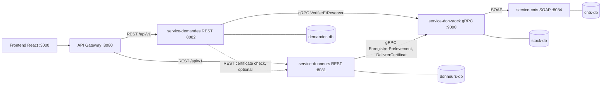
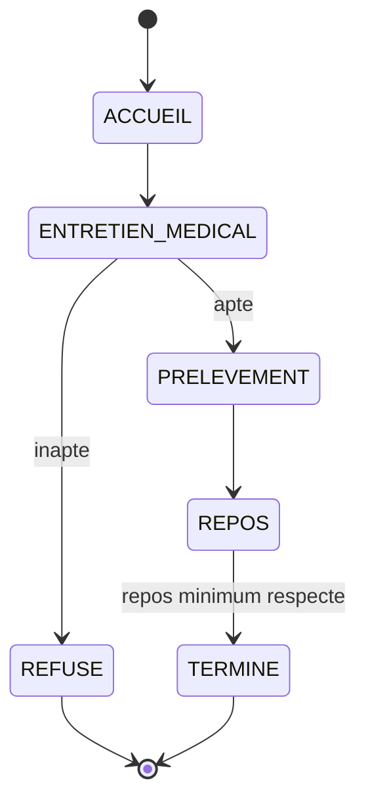
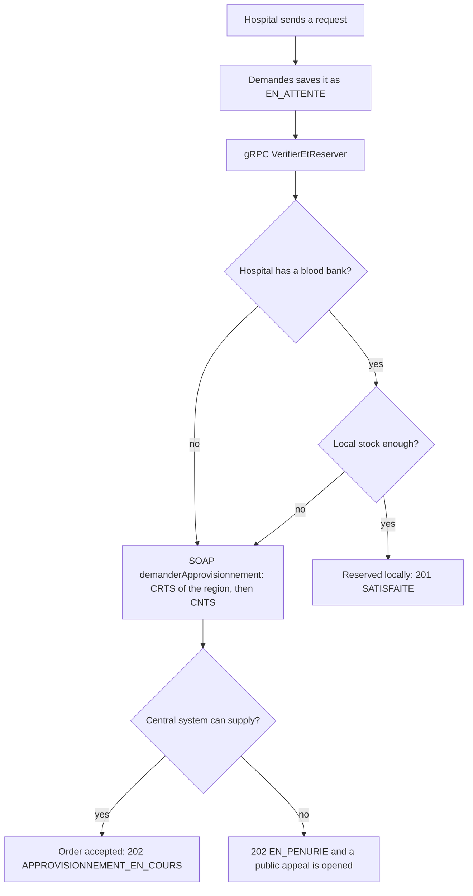

# SOA Mini-Project v2: Blood Donation Network based on the Tunisian CNTS guide

**Source study:** `Guide du don de sang et gestion des stocks en Tunisie.md` (CNTS, CRTS and hospital blood banks)
**Assignment:** `Mini-projet_SOA2026.pdf` (Dr. Ghada Feki), Java 17, Spring Boot 3.3.x, REST + gRPC + SOAP, Docker, GitLab
**Team:** 7 final-year students, IIT Sfax

This file regenerates the whole solution so that the domain follows the study: who can donate, how a donation is done, how blood is stored at the national, regional and hospital level, and how hospitals get blood. The team structure, the three protocols, the tools and the contract-first method stay the same as in v1.

**Update v2.1:** a donor can book from home on free slots (not only at the centre), and every completed donation gives the donor a donation certificate issued by the CNTS system. The changes are in sections 0, 1, 3, 4, 6, 7, 8, 9, 10, 11, 12, 13, 14, 15, 16 and 17.

## Table of contents

0. What changed compared to v1
1. What the study says and how the app uses it
2. Problem, actors and scope
3. Domain model
4. Services and protocols (assignment check)
5. Architecture
6. Contracts
7. Business flows
8. State machines
9. Business rules
10. Resilience design
11. Frontend
12. Roles and detailed tasks
13. Collaboration plan
14. Tests and demo script
15. Seed data
16. Configuration variables
17. Assumptions and open decisions
18. What to update from v1, and grading checklist

---

## 0. What changed compared to v1

| Topic | v1 | v2 (from the study) |
|---|---|---|
| Domain | Donors, hospital requests, a generic partner | The real chain: donors, collection centres, CNTS and CRTS central stock, hospital blood banks, public appeals, family compensation |
| Donor service | Donor CRUD and search | Donor, eligibility rules, temporary deferral, collection centres, booking from home on slots, the 4-step donation visit, donation certificate |
| Stock | One stock per blood group | Stock per place (CNTS, CRTS, hospital bank) x blood group x blood component |
| Partner SOAP service | `service-partenaire` (certificate and transfer) | `service-cnts`: simulated CNTS/CRTS central information system (declare a collection, supply orders, issue the donation certificate) |
| Requests | Group, quantity, urgency | Reason (surgery, emergency, treatment), component, anonymous patient reference, compensation donors, public appeal on shortage |
| gRPC contract | `VerifierDisponibilite`, `SuivreNiveauxStock` | `VerifierEtReserver`, `ConsulterReservation`, `EnregistrerPrelevement`, `DelivrerCertificat`, `SuivreNiveauxStock` |
| Inter-service calls | 2 | 3 paths (REST to gRPC twice, gRPC to SOAP once), plus 1 optional REST call |
| Donor booking | not detailed | Booking from home on centre slots with a capacity, or a walk-in visit at the centre |
| Proof of donation | none in v2, a certificate operation in v1 | Donation certificate issued by the CNTS system after a completed donation, also used as proof for family compensation |

**Unchanged:** 4 business services + Gateway + frontend, one database per service, REST/gRPC/SOAP split, contract-first, Resilience4j patterns, Docker Compose, GitLab and GitLab CI, the 7 student roles.

**Service renaming:** `service-partenaire` becomes `service-cnts` (port 8084). Everything else keeps its name.

---

## 1. What the study says and how the app uses it

| Fact in the study | Feature in the app | Service |
|---|---|---|
| Donor age 18 to 70, first donation recommended up to 65 | Eligibility rule on age | Donneurs |
| Minimum weight 50 kg | Eligibility rule on weight | Donneurs |
| Good health, hydrated, not fasting | Questionnaire at reception | Donneurs |
| Temporary contraindications: tattoo, piercing, surgery, antibiotics, recent infection | Temporary deferral with an end date and a reason | Donneurs |
| Reception with ID card (CIN) and health questionnaire | Donation step 1 (`ACCUEIL`) | Donneurs |
| Confidential medical interview: blood pressure, haemoglobin, safety | Donation step 2 (`ENTRETIEN_MEDICAL`), decision fit or unfit | Donneurs |
| Collection of 450 ml in 8 to 10 minutes | Donation step 3 (`PRELEVEMENT`), volume 450 ml | Donneurs, then Don & Stock |
| Rest and snack for 15 to 20 minutes | Donation step 4 (`REPOS`), minimum rest before `TERMINE` | Donneurs |
| (Not in the study) Proof of donation for the donor and for family compensation | Donation certificate issued by the CNTS system after a completed donation | Donneurs, Don & Stock, CNTS |
| Permanent centres (CNTS Tunis, CRTS such as Sfax, hospital blood banks) and mobile collections (universities, companies, public spaces) | Collection centres of several types | Donneurs |
| Online appointment (from home) or walk-in at the centre | Booking from home on slots with a capacity per centre, or a walk-in visit started by the reception | Donneurs |
| Hospital asks for blood for surgery, emergency or specific treatment | Request with a reason | Demandes |
| Shortage leads to public appeals to donate | Public appeal resource, opened automatically on shortage | Demandes |
| Families of hospitalized patients are asked to bring 2 to 3 donors | Compensation counter on a request | Demandes |
| Big hospitals have an internal blood bank | Place with a local stock | Don & Stock |
| Small structures and clinics have no permanent stock and order from CNTS/CRTS | Place without stock: the order goes straight to the central system | Don & Stock, CNTS |
| CNTS/CRTS: strategic stock; hospital: small stock managed just in time | Two stock tiers with different thresholds | Don & Stock, CNTS |
| CNTS/CRTS collect, qualify, separate components (red cells, plasma, platelets) | Declaration of a collection, status `EN_QUALIFICATION`, three components | CNTS, Don & Stock |
| Hospitals order pouches; in a local shortage the regional centre or CNTS supplies urgently | Supply order: the regional CRTS first, then the CNTS | CNTS |
| Blood products have a limited life | Optional expiry dates and a scheduled job | Don & Stock |

**What the study does not say** (the app uses configurable values, see section 17): deferral durations, blood pressure and haemoglobin limits, the minimum time between two donations, the shelf life of each component, and the stock alert thresholds.

---

## 2. Problem, actors and scope

### 2.1 Problem

Blood in Tunisia flows from donors to the CNTS and regional centres, and from there to hospital blood banks. Hospitals with a bank keep a small just-in-time stock, small clinics keep none, and a local shortage forces calls to the regional centre, the CNTS or the public. The information is spread over many places: nobody sees the donor rules, the stocks of every tier and the open requests in one view.

Our application connects the whole chain in one system: eligibility and appointments for donors, a guided donation visit at the centre, stock per place with live levels, hospital requests that use the local bank first and the central stock second, and public appeals when blood is missing.

### 2.2 Actors

| Actor | What they do |
|---|---|
| Donor | Registers, checks eligibility, books from home or at the centre, downloads the donation certificate, sees open public appeals |
| Centre staff (reception, doctor, nurse) | Runs the 4-step donation visit, records the interview and the collection |
| Hospital staff | Creates blood requests for patients, follows them, sees the stock, follows compensation donors |
| CNTS/CRTS (simulated legacy system) | Receives declared collections, answers supply orders |
| Admin | Sees the strategic stock, manages reference data |

### 2.3 Scope

**In scope:** everything in section 1 marked as a feature.
**Out of scope:**
- The real CNTS appointment website and the real CNTS information system: they are simulated.
- Real biological qualification, patient identity and medical records. A request carries only an anonymous patient reference.
- Real transport and logistics of pouches: delivery is simulated with a delay.
- The legal value of the certificate: it is a simulated document with a number that can be checked in the app.
- Automatic calls or messages to donors (an optional bonus with Kafka or RabbitMQ).

**Privacy:** the study says the medical interview is confidential. The app stores only what the rules need (haemoglobin, blood pressure, decision), restricts them to centre staff by role, and never stores a patient's name.

---

## 3. Domain model

### 3.1 Reference lists

| List | Values |
|---|---|
| Blood groups (8) | `A_POS`, `A_NEG`, `B_POS`, `B_NEG`, `AB_POS`, `AB_NEG`, `O_POS`, `O_NEG` |
| Components (3) | `CGR` (red cells), `PLASMA`, `PLAQUETTES` |
| Place types | `CNTS`, `CRTS`, `BANQUE_HOPITAL`, `CLINIQUE_SANS_STOCK`, `COLLECTE_MOBILE` |
| Request reasons | `CHIRURGIE`, `URGENCE`, `TRAITEMENT` |
| Urgency | `NORMALE`, `HAUTE`, `CRITIQUE` |
| Deferral reasons | `TATOUAGE`, `PIERCING`, `CHIRURGIE`, `ANTIBIOTIQUES`, `INFECTION` |

The exact lists are frozen at the contracts meeting.

### 3.2 Entities by service

**service-donneurs (REST, `donneurs-db`)**

| Entity | Main fields |
|---|---|
| Donneur | id, cin (unique), nom, prenom, dateNaissance, poidsKg, groupeSanguin, ville, telephone, premierDon |
| Ajournement | id, donneurId, motif, dateDebut, dateFin |
| Centre | id, nom, type, ville, dateDebut and dateFin (for mobile collections) |
| Creneau | id, centreId, debut, fin, capacite (number of places) |
| RendezVous | id, donneurId, centreId, creneauId, canal (`EN_LIGNE` from home, or `SUR_PLACE` at the centre), demandeId (optional, for compensation), statut (`PLANIFIE`, `ANNULE`, `ABSENT`, `TERMINE`) |
| Don | id, donneurId, centreId, rendezVousId (optional), etape, decision, statutSynchro (`A_SYNCHRONISER`, `SYNCHRONISE`), numeroDonNational, certificatStatut (`A_EMETTRE`, `EMIS`), numeroCertificat, dateCertificat |
| EtapeDon | id, donId, etape, dateHeure, donnees (CIN check and questionnaire; blood pressure, haemoglobin and decision; volume and duration; rest start and end) |

**service-demandes (REST, `demandes-db`)**

| Entity | Main fields |
|---|---|
| Demande | id, hopitalId, hopitalNom, patientRef (anonymous), motif, groupeSanguin, composant, quantitePoches, urgence, statut, referenceApprovisionnement, compensationDemandee (2 to 3), compensationRecue, dateCreation |
| AppelDon | id, demandeId (optional), groupeSanguin, composant, centreCibleId, statut (`OUVERT`, `FERME`), dateOuverture, dateFermeture |
| Compensation | id, demandeId, numeroCertificat (unique), dateEnregistrement |

**service-don-stock (gRPC, `stock-db`)**

| Entity | Main fields |
|---|---|
| Lieu | id, nom, type, region, stockLocal (true or false) |
| StockNiveau | lieuId, groupeSanguin, composant, disponible, reserve, enQualification, enTransit, seuilAlerte |
| Reservation | demandeId (unique), lieuId, groupeSanguin, composant, quantite, source (`LOCAL` or `CENTRAL`), statut, referenceApprovisionnement, eta |
| Prelevement | donId (unique), donneurId, centreId, groupeSanguin, volumeMl, numeroDonNational, statut |

**service-cnts (SOAP, `cnts-db`)**

| Entity | Main fields |
|---|---|
| StockCentral | centreId (CNTS or a CRTS), groupeSanguin, composant, quantite |
| PrelevementDeclare | numeroDonNational, donIdLocal, groupeSanguin, volumeMl, centreId, statut (`QUALIFICATION_EN_COURS`) |
| Approvisionnement | reference, hopitalId, groupeSanguin, composant, quantiteDemandee, quantiteAccordee, centreSource, delaiMinutes, statut |
| Certificat | numeroCertificat, numeroDonNational, donIdLocal, centreId, dateDon, dateEmission, statut (`VALIDE`) |

---

## 4. Services and protocols (assignment check)

| Service | Style | Why this style |
|---|---|---|
| Gateway | REST | Single entry point for the frontend |
| `service-donneurs` | **REST** | Exposed to the web frontend for donors and centre staff |
| `service-demandes` | **REST** | Exposed to the web frontend for hospital staff |
| `service-don-stock` | **gRPC** | Internal, fast, and a streaming RPC for live stock |
| `service-cnts` | **SOAP** | Simulated legacy national system, contract with XSD and WSDL |

**Inter-service calls (3, plus 1 optional; the assignment needs 2 with 2 protocols)**

| # | Caller | Called | Protocol | Purpose |
|---|---|---|---|---|
| 1 | `service-demandes` | `service-don-stock` | gRPC unary | Check and reserve blood for a request |
| 2 | `service-donneurs` | `service-don-stock` | gRPC unary | Declare a collected pouch after step 3, and ask for the donation certificate when the visit is finished |
| 3 | `service-don-stock` | `service-cnts` | SOAP | Order supply from CRTS/CNTS, declare a collection for qualification, issue the donation certificate |
| 4 (optional) | `service-demandes` | `service-donneurs` | REST | Check a donation certificate presented for compensation |

**Assignment checks**

| Requirement | How v2 meets it |
|---|---|
| At least 3 business resources | Donneur, RendezVous, Don, Demande, AppelDon, StockNiveau, Reservation, Approvisionnement |
| One REST, one gRPC, one SOAP service | Donneurs and Demandes, Don & Stock, CNTS |
| At least 2 real calls with 2 protocols | Calls 1, 2 (gRPC) and 3 (SOAP) |
| One database per service | `donneurs-db`, `demandes-db`, `stock-db`, `cnts-db` |
| gRPC: unary and streaming RPC, deadline | `VerifierEtReserver` and `SuivreNiveauxStock`, deadline on every client |
| SOAP: contract-first, at least 2 operations, Fault | XSD first, `enregistrerPrelevement`, `demanderApprovisionnement` and `delivrerCertificatDon`, faults |
| Resilience: timeout, circuit breaker or retry, fallback | Section 10 |

---

## 5. Architecture



| Component | Port |
|---|---|
| Frontend | 3000 |
| Gateway | 8080 |
| service-donneurs | 8081 |
| service-demandes | 8082 |
| service-don-stock | 9090 (gRPC), 8083 (Actuator) |
| service-cnts | 8084 (`/ws`, WSDL at `/ws/cnts.wsdl`) |

Design rules: one database per service, services find each other through Docker Compose DNS names, configuration from environment variables, stateless services, logs on stdout, Actuator health on every service, an explicit timeout or deadline on every network call.

**How the two stock tiers map to the system:** the real central stock of CNTS and CRTS lives in `service-cnts` (the legacy system we do not control). The hospital banks' stock lives in `service-don-stock`. A hospital request uses the local stock first, and asks the central system only when the local stock is missing or the hospital has no bank.

---

## 6. Contracts

All contracts are written before the code and merged in `contracts/`.

### 6.1 REST: service-donneurs (`contracts/openapi/donneurs.yaml`)

| Method and path | Purpose | Codes |
|---|---|---|
| `POST /api/v1/donneurs` | Register a donor | 201, 400, 409 (CIN already exists) |
| `GET /api/v1/donneurs` | Search by `groupe`, `ville`, pagination | 200 |
| `GET`, `PUT`, `DELETE /api/v1/donneurs/{id}` | Read, update, delete | 200, 204, 404 |
| `GET /api/v1/donneurs/{id}/eligibilite` | Eligibility result with reasons | 200, 404 |
| `POST /api/v1/donneurs/{id}/ajournements` | Add a temporary deferral (doctor) | 201, 400, 404 |
| `GET /api/v1/centres` | List centres, filters `type`, `ville` | 200 |
| `GET /api/v1/centres/{id}/creneaux` | List the free slots of a centre for a day (`date`), used when booking from home | 200, 404 |
| `POST /api/v1/centres/{id}/creneaux` | Create slots with a capacity (staff or admin) | 201, 400, 404 |
| `POST`, `GET /api/v1/rendez-vous` | Book a slot from home or at the centre, list (filters `centreId`, `date`, `statut`) | 201, 200, 400, 409 (slot full, active deferral, not eligible) |
| `GET`, `PATCH /api/v1/rendez-vous/{id}` | Read, cancel or move to another slot | 200, 404, 409 |
| `POST /api/v1/dons` | Start a donation visit (step 1, reception) | 201, 400, 409 |
| `GET /api/v1/dons/{id}` | Read a donation visit | 200, 404 |
| `POST /api/v1/dons/{id}/entretien` | Step 2: blood pressure, haemoglobin, decision | 201, 409 (wrong step) |
| `POST /api/v1/dons/{id}/prelevement` | Step 3: collection of 450 ml | 201, 409 |
| `POST /api/v1/dons/{id}/repos` | Step 4: rest | 201, 409 |
| `GET /api/v1/dons/{id}/certificat` | Read the donation certificate (JSON, or PDF with `Accept: application/pdf`); status `EN_PREPARATION` or `EMIS` | 200, 404, 409 (visit not finished) |
| `GET /api/v1/certificats/{numero}` | Verify a certificate by its number (public, returns only validity, date and centre) | 200, 404 |

### 6.2 REST: service-demandes (`contracts/openapi/demandes.yaml`)

| Method and path | Purpose | Codes |
|---|---|---|
| `POST /api/v1/demandes` | Create a request (checks and reserves blood) | 201, 202, 400 |
| `GET /api/v1/demandes` | List, filters `statut`, `hopitalId` | 200 |
| `GET /api/v1/demandes/{id}` | Read | 200, 404 |
| `PATCH /api/v1/demandes/{id}` | Cancel, or correct `compensationRecue` by hand (fallback) | 200, 400, 404 |
| `POST /api/v1/demandes/{id}/compensations` | Register a compensation donor by certificate number (checked in Donneurs) | 201, 400, 404, 409 (number already used) |
| `POST`, `GET /api/v1/appels` | Open or list public appeals (list is public) | 201, 200 |
| `PATCH /api/v1/appels/{id}` | Close an appeal | 200, 404 |
| `GET /api/v1/stock/niveaux` | Current stock levels (REST bridge to gRPC) | 200, 503 |
| `GET /api/v1/stock/niveaux/flux` | Live levels with server-sent events (proposal) | 200 |

All errors use one JSON format: timestamp, status, error, message, path.

### 6.3 gRPC: service-don-stock (`contracts/proto/donstock/v1/donstock.proto`)

```
service DonStockService {
  rpc VerifierEtReserver (ReservationRequest)  returns (ReservationResponse);   // unary
  rpc ConsulterReservation (ConsultationRequest) returns (ReservationResponse); // unary
  rpc EnregistrerPrelevement (PrelevementRequest) returns (PrelevementResponse); // unary
  rpc DelivrerCertificat (CertificatRequest) returns (CertificatResponse);       // unary
  rpc SuivreNiveauxStock (SuiviRequest) returns (stream NiveauStock);           // server streaming
}
```

| Message | Main fields |
|---|---|
| `ReservationRequest` | `demande_id`, `lieu_id`, `groupe_sanguin`, `composant`, `quantite`, `urgence` |
| `ReservationResponse` | `statut` (`RESERVEE_STOCK_LOCAL`, `APPROVISIONNEMENT_COMMANDE`, `STOCK_INSUFFISANT_PARTOUT`), `reference`, `centre_source`, `eta_minutes` |
| `PrelevementRequest` | `don_id`, `donneur_id`, `centre_id`, `groupe_sanguin`, `volume_ml`, `date_prelevement` |
| `PrelevementResponse` | `numero_don_national`, `statut` |
| `CertificatRequest` | `don_id`, `numero_don_national`, `donneur_ref`, `centre_id`, `date_don` |
| `CertificatResponse` | `numero_certificat`, `date_emission`, `statut` |
| `SuiviRequest` | `lieu_id` (optional), `groupe_sanguin` (optional) |
| `NiveauStock` | `lieu_id`, `groupe_sanguin`, `composant`, `quantite`, `seuil_alerte`, `niveau` (`BAS`, `MOYEN`, `HAUT`), `timestamp` |

Package `donstock.v1`. Never reuse a field number; use `reserved` for removed fields; a breaking change means `v2`.

**gRPC status codes:** `INVALID_ARGUMENT` (quantity below 1, unknown group), `NOT_FOUND` (unknown place or reservation), `FAILED_PRECONDITION` (inconsistent state), `UNAVAILABLE` and `DEADLINE_EXCEEDED` (technical problems). Repeating a call with the same `demande_id` or `don_id` returns the first result (idempotency).

### 6.4 SOAP: service-cnts (`contracts/wsdl-xsd/cnts.xsd`, then generated `cnts.wsdl`)

| Operation | Request | Response | Faults |
|---|---|---|---|
| `enregistrerPrelevement` | `donIdLocal`, `groupeSanguin`, `volumeMl`, `centreId`, `datePrelevement` | `numeroDonNational`, `statut` (`QUALIFICATION_EN_COURS`), `composantsPrevus` | `PrelevementInvalideFault` (unknown group, volume different from 450 ml, date in the future) |
| `demanderApprovisionnement` | `hopitalId`, `region`, `groupeSanguin`, `composant`, `quantite`, `urgence` | `reference`, `quantiteAccordee`, `centreSource`, `delaiMinutes`, `statut` | `StockCentralInsuffisantFault` (neither the CRTS nor the CNTS can supply) |
| `delivrerCertificatDon` | `donIdLocal`, `numeroDonNational`, `donneurRef`, `centreId`, `dateDon` | `numeroCertificat`, `dateEmission`, `statut` (`VALIDE`) | `CertificatRefuseFault` (donation unknown or not declared) |

The XSD is written first and merged alone, before any code.

---

## 7. Business flows

### 7.1 Eligibility and appointment

1. The donor registers with CIN, birth date, weight, blood group, city and phone number. A duplicate CIN gives 409.
2. `GET /donneurs/{id}/eligibilite` applies the rules of section 9 and returns `ELIGIBLE`, `AJOURNE_TEMPORAIREMENT` or `NON_ELIGIBLE`, with the reasons.
3. **Booking from home:** the donor opens the web app on a phone or a computer, chooses a centre (permanent centre, hospital bank or mobile collection), sees the free slots of a day and books one. Booking checks eligibility again and checks that the slot has a free place (409 otherwise). The appointment is created with `canal = EN_LIGNE`. The donor can cancel it or move it to another slot from home.
4. **At the centre:** the reception can also create an appointment (`canal = SUR_PLACE`) or start a walk-in visit with no appointment, as the study allows.
5. On the day, the reception links the visit to the appointment. The appointment becomes `TERMINE` when the visit ends.
6. Optional reminder (bonus): an event `RendezVousPlanifie` is published and consumed by a small notification program that simulates an SMS or an email. This is a good candidate for the messaging bonus.

### 7.2 Donation visit (4 steps)



1. **Reception:** the staff checks the CIN and records the health questionnaire.
2. **Medical interview:** the doctor records blood pressure and haemoglobin and decides fit or unfit. An unfit decision can add a temporary deferral.
3. **Collection:** the nurse records the volume (450 ml) and the duration. Then `service-donneurs` calls `service-don-stock` (gRPC `EnregistrerPrelevement`). `service-don-stock` calls `service-cnts` (SOAP `enregistrerPrelevement`), receives the national donation number, and stores the pouch as `en_qualification`.
4. **Rest:** at least the minimum rest time (15 minutes, configurable; the study says 15 to 20) before the visit becomes `TERMINE`.

A step cannot be skipped or repeated: a wrong order gives 409. Later, a scheduled job simulates the qualification and moves the pouches from `en_qualification` to `disponible`; the stream sends the new level.

**Donation certificate (automatic, after step 4).** When the visit becomes `TERMINE`, `service-donneurs` calls `service-don-stock` (gRPC `DelivrerCertificat`), which calls `service-cnts` (SOAP `delivrerCertificatDon`). The CNTS system returns a unique certificate number. Donneurs stores it in the donation (`certificatStatut = EMIS`), and the donor can see and download the certificate from home (`GET /dons/{id}/certificat`).
- The certificate shows: certificate number, national donation number, donor name, masked CIN, donation date, centre, volume, and the issuing authority (CNTS). It shows no health data (no blood pressure, haemoglobin or interview decision).
- A refused visit (`REFUSE`) gets no certificate.
- If the CNTS system is down, the visit stays `TERMINE` with `certificatStatut = A_EMETTRE`. The donor sees "certificate being prepared", and a retry job issues it later.
- The call is idempotent by `don_id`: the same donation never gets two certificates.

### 7.3 Hospital request (the main flow)



| Situation | Don & Stock answer | Request status | HTTP |
|---|---|---|---|
| Hospital bank has enough | `RESERVEE_STOCK_LOCAL` | `SATISFAITE` | 201 |
| No bank, or not enough, and CRTS/CNTS accepts | `APPROVISIONNEMENT_COMMANDE` | `APPROVISIONNEMENT_EN_COURS` | 202 |
| Nobody has enough | `STOCK_INSUFFISANT_PARTOUT` | `EN_PENURIE`, public appeal opened | 202 |
| Stock service down (fallback) | none | `EN_ATTENTE` | 202 |
| Invalid data | none | not saved | 400 |

Reservation and check happen in one database transaction in Don & Stock, so two hospitals cannot take the same pouches. A central order creates a reservation in transit. A scheduled delivery simulator then adds the pouches to the hospital stock after a delay. A reconciliation job in Demandes calls `ConsulterReservation` for requests in `EN_ATTENTE` or `APPROVISIONNEMENT_EN_COURS` and moves them to `SATISFAITE` when the pouches arrive.

### 7.4 Public appeal and compensation

- When a request ends in `EN_PENURIE`, Demandes opens an appeal for that blood group and component. Appeals are public: donors see them and book an appointment. An appeal is closed by hospital staff, or by the reconciliation job when the stock is back.
- For compensation, the hospital sets `compensationDemandee` (2 to 3 donors, from the study). A family donor books from home (the appointment can carry the `demandeId`), donates, and receives a certificate. The family gives the certificate number to the hospital, which registers it with `POST /demandes/{id}/compensations`. Demandes checks the number with `GET /certificats/{numero}` in Donneurs (a REST call with a timeout and a circuit breaker) and counts each certificate only once. `compensationRecue` is the number of valid certificates. If Donneurs is down, staff can correct the counter by hand.

### 7.5 Live stock

`SuivreNiveauxStock` is a server-streaming RPC. It sends the current levels first, then each change: new qualified pouches, reservations, deliveries and expiries. A scheduler simulates collections, qualification, consumption and deliveries so the stream always has data. The browser cannot speak gRPC easily, so Demandes exposes the stream as server-sent events (`/api/v1/stock/niveaux/flux`), or the frontend polls `/api/v1/stock/niveaux`. The Gateway must not buffer or cut this connection.

### 7.6 Failures

| Failure | What happens |
|---|---|
| Don & Stock down while a request arrives | Deadline 2 s, circuit breaker opens after several failures, fallback keeps the request `EN_ATTENTE` and answers 202; the reconciliation job completes it later |
| Don & Stock down at the end of the collection step | The donation visit continues; the donation is marked `A_SYNCHRONISER` and a retry job declares it later, so no real donation is lost |
| CNTS system slow or down | SOAP timeout, 3 retries with backoff, circuit breaker; fallback stores the order or declaration as `A_CONFIRMER` or `A_DECLARER` for a later retry |
| The same call is sent twice | `demande_id` and `don_id` make the calls idempotent: no double reservation, no double pouch |

---

## 8. State machines

| Object | States and transitions |
|---|---|
| Don (visit) | `ACCUEIL` to `ENTRETIEN_MEDICAL` to `PRELEVEMENT` to `REPOS` to `TERMINE`; `ENTRETIEN_MEDICAL` to `REFUSE` when unfit |
| Don (sync) | `A_SYNCHRONISER` to `SYNCHRONISE` |
| Don (certificate) | `A_EMETTRE` to `EMIS`, only after `TERMINE` |
| Rendez-vous | `PLANIFIE` to `TERMINE`, `ANNULE` or `ABSENT` |
| Demande | `EN_ATTENTE` to `SATISFAITE`, or to `APPROVISIONNEMENT_EN_COURS` then `SATISFAITE`, or to `EN_PENURIE`; any open state to `ANNULEE` |
| Appel | `OUVERT` to `FERME` |
| Stock counters | collection: `enQualification` to `disponible`; reservation: `disponible` to `reserve`; central order: `enTransit` to `disponible`; expiry: `disponible` decreases |

---

## 9. Business rules

Values in `code` are configurable (section 16).

| # | Rule | Where | Result |
|---|---|---|---|
| R1 | Donor age must be between 18 and 70 | Donneurs | `NON_ELIGIBLE` |
| R2 | A first donation after 65 is not recommended | Donneurs | `NON_ELIGIBLE`, reason `PREMIER_DON_APRES_65` (to confirm with CNTS) |
| R3 | Weight must be at least 50 kg | Donneurs | `NON_ELIGIBLE` |
| R4 | A donor with an active deferral cannot book or donate | Donneurs | `AJOURNE_TEMPORAIREMENT`, until `dateFin` |
| R5 | A CIN exists only once | Donneurs | 409 |
| R6 | Donation steps follow the order reception, interview, collection, rest | Donneurs | 409 on a wrong order |
| R7 | An unfit decision ends the visit as `REFUSE` | Donneurs | no collection |
| R8 | The collected volume is 450 ml | Donneurs, CNTS | `PrelevementInvalideFault` otherwise |
| R9 | The visit ends only after the minimum rest (15 minutes) | Donneurs | 409 before that time |
| R10 | Blood group and component must be known values | all | 400 or gRPC `INVALID_ARGUMENT` |
| R11 | Request quantity must be at least 1 | Demandes | 400 |
| R12 | A hospital without a blood bank always goes to the central system | Don & Stock | `APPROVISIONNEMENT_COMMANDE` or `STOCK_INSUFFISANT_PARTOUT` |
| R13 | A hospital with a bank uses its local stock first | Don & Stock | `RESERVEE_STOCK_LOCAL` if enough |
| R14 | Central supply tries the regional CRTS first, then the CNTS | CNTS | `centreSource` in the answer |
| R15 | A `CRITIQUE` request is marked as an emergency supply | CNTS | shorter `delaiMinutes` |
| R16 | Nobody can supply: the request becomes `EN_PENURIE` and an appeal opens | Demandes | 202 |
| R17 | Compensation asks for 2 to 3 donors per hospitalized patient | Demandes | field `compensationDemandee` between 2 and 3 |
| R18 | The same `demande_id` or `don_id` never creates a second effect | Don & Stock | same answer as the first call |
| R19 | A patient is identified only by an anonymous reference | Demandes | no name stored |
| R20 | Interview data is visible only to centre staff and admin | Gateway, Donneurs | 403 otherwise |
| R21 | A donor can book from home any open slot of a centre | Donneurs | `canal = EN_LIGNE` |
| R22 | A slot cannot hold more appointments than its capacity | Donneurs | 409 |
| R23 | A donor can have only one active appointment per day (app rule) | Donneurs | 409 |
| R24 | A certificate is issued only after the visit is `TERMINE`, never for `REFUSE` | Donneurs, CNTS | 409, or `CertificatRefuseFault` |
| R25 | One donation gets one certificate; the same `don_id` returns the same certificate | Don & Stock, CNTS | idempotent |
| R26 | A certificate number can count only once for compensation | Demandes | 409 |
| R27 | The certificate shows no health data | Donneurs | privacy |

---

## 10. Resilience design

| Call | Protection | Fallback |
|---|---|---|
| Demandes to Don & Stock (`VerifierEtReserver`) | Deadline `GRPC_DEADLINE_MS` (2000), Resilience4j circuit breaker | Request stays `EN_ATTENTE`, answer 202, reconciliation job |
| Donneurs to Don & Stock (`EnregistrerPrelevement`, `DelivrerCertificat`) | Deadline, circuit breaker, idempotency by `don_id` | Don marked `A_SYNCHRONISER`, or certificate `A_EMETTRE`, retry job |
| Don & Stock to CNTS (`demanderApprovisionnement`, `enregistrerPrelevement`, `delivrerCertificatDon`) | Timeout `SOAP_TIMEOUT_MS` (3000), retry 3 times with exponential backoff from 500 ms, circuit breaker | `A_CONFIRMER`, `A_DECLARER` or `A_EMETTRE`, retry job |
| Demandes to Donneurs (certificate check, optional) | Timeout, circuit breaker | Staff correct `compensationRecue` by hand |
| Gateway to services | Connect and response timeouts, optional circuit breaker | JSON 503 or 504 error |

Retries only happen on idempotent calls. The CNTS service has simulation switches (`CNTS_LATENCY_MS`, `CNTS_FAIL_RATE`) to demonstrate the behaviour live.

---

## 11. Frontend

One React app on port 3000, talking only to the Gateway. Mocks (MSW) first.

| Area | Screens |
|---|---|
| Public and donor | Registration, eligibility result with reasons, book from home (choose centre, day and free slot), my appointments (cancel or move), my donation certificates (view, print or download as PDF), open public appeals |
| Centre staff | Today's appointments, donation board with the four steps and one form per step (reception with CIN check, interview, collection with volume, rest countdown), deferral form, slot management, certificate status of each visit |
| Hospital | New request form (reason, group, component, quantity, urgency, patient reference, compensation), request list with status badges, request details with delivery status, and compensation progress with the certificate numbers entered by the family |
| Stock dashboard | Gauges per blood group and component, a selector for the place (hospital, CRTS, CNTS), live updates |

---

## 12. Roles and detailed tasks

Task IDs look like `S3-09`. Create one GitLab issue per task. Each service starts with its contract, merged alone, before any business code.

### Student 1: Frontend (React)
- S1-01 Vite and React project, MSW mocks for donneurs, centres, rendez-vous, dons, demandes, appels and stock.
- S1-02 API layer with `VITE_API_BASE_URL` and `VITE_USE_MOCKS`, one place for error messages.
- S1-03 Donor area: registration, eligibility result, booking from home (centre, day, free slot), my appointments, my certificates with a print or PDF button (show "being prepared" when not ready), open appeals.
- S1-04 Centre staff area: appointments list and the four-step donation board with forms and rest countdown.
- S1-05 Hospital area: request form, list with status badges, details with compensation counter and entry of certificate numbers.
- S1-06 Stock dashboard with place selector and a `useStockLevels()` hook (fake data first).
- S1-07 Loading, empty and error states for 400, 404, 409 and 202.
- S1-08 Unit tests (Vitest, React Testing Library).
- S1-09 Login and role-based menus (bonus).
- S1-10 Switch to the Gateway, fix CORS with Student 2, report contract gaps as issues.
- S1-11 Live stock through server-sent events, with polling as a backup.
- S1-12 Multi-stage Dockerfile (Node build, Nginx on 3000).
- S1-13 Manual test list, screenshots, README and report part.

### Student 2: Security and Gateway
- S2-01 Spring Cloud Gateway project (Boot 3.3.x, Java 17, Actuator).
- S2-02 Routes from env variables: `/api/v1/donneurs`, `/centres`, `/rendez-vous`, `/dons` to Donneurs; `/demandes`, `/appels`, `/stock` to Demandes. Add `/certificats` and `/centres/{id}/creneaux` to Donneurs.
- S2-03 CORS from `CORS_ALLOWED_ORIGINS`, preflight test.
- S2-04 Explicit connect and response timeouts; a longer or disabled response timeout for the SSE route.
- S2-05 Health, stdout logs, `X-Request-Id` filter.
- S2-06 Standard JSON 503 and 504 errors.
- S2-07 Login endpoint with demo users for the roles `DONOR`, `STAFF_CENTRE`, `HOPITAL`, `ADMIN` from env variables; JWT signed with `JWT_SECRET` (bonus).
- S2-08 Role rules: only staff and admin read interview data; hospitals create requests; donors manage their own data; appeals and centres are public for reading; certificate verification is public (no personal data); a certificate is readable only by its donor and by staff.
- S2-09 Optional per-IP rate limiter.
- S2-10 Tests with a mock backend: forwarding, CORS, 401, 403, 200, 503, SSE passthrough.
- S2-11 Dockerfile, failure demo, README and report part.

### Student 3: Donneurs service (REST)
- S3-01 OpenAPI first, in `contracts/openapi/donneurs.yaml` (section 6.1); reviewed by Students 1, 2 and 6.
- S3-02 Project and layers (`controller`, `service`, `repository`, `model`, `dto`, `exception`).
- S3-03 Flyway schema: donneur, ajournement, centre, creneau, rendez_vous, don (with certificate columns), etape_don; seed the centres and free slots.
- S3-04 Eligibility service with the rules R1 to R4 and a table-driven unit test.
- S3-05 Donor CRUD with validation and unique CIN.
- S3-06 Deferral endpoint, centres endpoint and slots endpoints.
- S3-07 Appointments from home: eligibility check, slot capacity (409 when full), one active appointment per day, cancel or move, list with filters.
- S3-08 Donation visit state machine (R6 to R9) with a step table; the appointment becomes `TERMINE` when the visit ends.
- S3-09 gRPC client to Don & Stock for `EnregistrerPrelevement` with deadline, circuit breaker, fallback `A_SYNCHRONISER`, and a retry job; after `TERMINE`, call `DelivrerCertificat`, store the certificate number and keep `A_EMETTRE` with a retry job as fallback; expose `GET /dons/{id}/certificat` (JSON and PDF) and the public `GET /certificats/{numero}`; use the fake gRPC server until the real one exists.
- S3-10 `@RestControllerAdvice` with the common error JSON.
- S3-11 Unit tests (eligibility, state machine) and integration tests (Testcontainers, fake gRPC, wrong step gives 409).
- S3-12 Dockerfile, Postman requests, README, REST part of the report.

### Student 4: Don & Stock service (gRPC)
- S4-01 `donstock.proto` first (section 6.3), reviewed by Students 3 and 6.
- S4-02 Project: gRPC starter compatible with Boot 3, protobuf plugin, Data JPA, Actuator, Spring Web Services, Resilience4j.
- S4-03 Flyway schema: lieu, stock_niveau, reservation, prelevement; seed places and levels.
- S4-04 `VerifierEtReserver`: local check for places with a bank, reservation in one transaction, idempotent by `demande_id`.
- S4-05 Central path: SOAP `demanderApprovisionnement` for places without a bank or without enough stock; create a reservation in transit.
- S4-06 Delivery simulator: after a delay, move pouches in transit to available stock and send a stream message.
- S4-07 `EnregistrerPrelevement`: idempotent by `don_id`, SOAP `enregistrerPrelevement`, store the pouch as `en_qualification`.
- S4-08 Qualification simulator: `en_qualification` becomes `disponible` after a delay.
- S4-09 `ConsulterReservation` and `DelivrerCertificat` (idempotent by `don_id`, calls the SOAP operation `delivrerCertificatDon`).
- S4-10 `SuivreNiveauxStock` streaming with optional filters; free resources on client cancel.
- S4-11 gRPC status mapping in one place (`INVALID_ARGUMENT`, `NOT_FOUND`, `FAILED_PRECONDITION`, `UNAVAILABLE`).
- S4-12 SOAP client (three operations) with `WebServiceTemplate`, timeout, retry with backoff, circuit breaker and the `A_CONFIRMER` or `A_DECLARER` fallbacks; map SOAP Faults.
- S4-13 Tests: in-process gRPC (each RPC and each status, stream receives several messages), `MockWebServiceServer` for success, Fault and timeout.
- S4-14 Reflection in the `demo` profile, Dockerfile, `grpcurl` examples, report part.

### Student 5: CNTS service (SOAP)
- S5-01 `cnts.xsd` first (section 6.4), merged alone before any code; reviewed by Student 4.
- S5-02 Project with Spring Web Services and a JAXB plugin that generates `jakarta.xml.bind` classes (check there is no `javax.*`).
- S5-03 `MessageDispatcherServlet` on `/ws/*` and the generated WSDL; commit `contracts/wsdl-xsd/cnts.wsdl`.
- S5-04 Flyway schema and seed: central stock for the CNTS and each CRTS by region, and the `certificat` table.
- S5-05 `enregistrerPrelevement` (validate group, volume 450 ml and date; create the national number; `PrelevementInvalideFault` otherwise) and `delivrerCertificatDon` (check that the national donation number exists; create a unique certificate number such as `CERT-2026-000001`; the same `donIdLocal` returns the same certificate; `CertificatRefuseFault` if the donation is unknown).
- S5-06 `demanderApprovisionnement`: try the regional CRTS first, then the CNTS; reduce the central stock; return source, quantity and delay; `StockCentralInsuffisantFault` when nobody can supply; a shorter delay for `CRITIQUE`.
- S5-07 SOAP Faults with `@SoapFault` and a detail element defined in the XSD.
- S5-08 `PayloadValidatingInterceptor` using the XSD.
- S5-09 Simulation switches `CNTS_LATENCY_MS` and `CNTS_FAIL_RATE`.
- S5-10 Optional job that slowly refills the central stock, to keep the demo alive.
- S5-11 Tests: unit tests for the rules; `MockWebServiceClient` for both operations, each Fault, invalid XML and the WSDL.
- S5-12 Sample SOAP requests in `tests-manuels/`, Dockerfile, README, SOAP part of the report, proof in Git that the XSD came first.

### Student 6: Demandes service (REST)
- S6-01 OpenAPI first, in `contracts/openapi/demandes.yaml` (section 6.2); reviewed by Students 1 and 2.
- S6-02 Project: Web, Validation, Data JPA, Actuator, springdoc, gRPC client starter, Resilience4j.
- S6-03 Fake Don & Stock gRPC server from the `.proto` (every answer, slow, error).
- S6-04 Flyway schema: demande, appel_don and compensation.
- S6-05 Request creation: validate, save `EN_ATTENTE`, call `VerifierEtReserver`, update the status; no database transaction held during the call.
- S6-06 Outcome mapping of section 7.3 (201, 202, 400) and the common error JSON.
- S6-07 Appeals: automatic opening on `EN_PENURIE`, manual open and close, public list.
- S6-08 Compensation: the 2 to 3 rule, registration by certificate number (`POST /demandes/{id}/compensations`), a REST check in Donneurs with timeout, circuit breaker and a manual fallback, each number counted once.
- S6-09 gRPC client with deadline `GRPC_DEADLINE_MS`, circuit breaker and fallback; share the Resilience4j configuration with Students 3 and 4 on Day 2.
- S6-10 Reconciliation job using `ConsulterReservation`.
- S6-11 Stock bridge: `GET /api/v1/stock/niveaux` and the SSE route `/flux` that reads the gRPC stream.
- S6-12 Tests: unit tests with a mocked stock client; integration tests with Testcontainers and the fake gRPC server, including a circuit breaker opening.
- S6-13 Replace the fake server by the real service; Dockerfile; `/actuator/circuitbreakers`; Postman, README, report part.

### Student 7: DevOps and cloud-native
- S7-01 GitLab project (private), members and teacher, protected `main` and `develop`, board, milestones, MR template with the Definition of Done.
- S7-02 Repository skeleton, `.gitignore`, README stub.
- S7-03 First `docker-compose.yml`: dedicated network, four PostgreSQL databases (`donneurs-db`, `demandes-db`, `stock-db`, `cnts-db`) with volumes and healthchecks, no published database ports.
- S7-04 `.env.example` with all variables (section 16), names and ports table for the team on Day 1.
- S7-05 Dockerfile template (multi-stage, slim Java 17 JRE, non-root, `wget` healthcheck) and review of each Dockerfile.
- S7-06 `.gitlab-ci.yml`: stages `build`, `test`, `package`, `smoke-test`; per-service jobs with `rules:changes`; Docker-in-Docker for Testcontainers.
- S7-07 Add every service to Compose with `depends_on: condition: service_healthy`, environment variables and restart policy.
- S7-08 Smoke-test job: `docker compose up -d --build --wait`, Gateway health, one donor registration and one request through the Gateway, then `down -v`.
- S7-09 Demo data profile that loads the seed data of section 15 into all databases, including free slots for the next days.
- S7-10 Fresh-machine test and secrets check (no secret in the repository, masked CI variables).
- S7-11 Failure demo scripts for the three scenarios of section 14 and a reliable pipeline.
- S7-12 Final README (run every command as written), Postman collection, `v1.0.0` tag, report parts on Docker, CI and cloud-native.
- S7-13 Optional bonus: RabbitMQ or Kafka for donor notifications, or OpenTelemetry with Jaeger.

### Everyone (final phase)
- Report of 8 to 12 pages (each student writes about their service; the leader writes the introduction, the study summary, the protocol table, difficulties and limits).
- Fresh-machine test by a teammate who did not write the code.
- Git history check for every member.
- Two timed rehearsals of the 15-minute demo and a recorded backup.
- Five likely questions and answers per student, and a quiz between students.

### Team leader
Run the kickoff meeting; check the exit criteria of each phase; keep the board up to date and unblock people within half a day; review the contract merge requests first; check the project against the grading grid at the end of each phase; organize the rehearsals and the report.

---

## 13. Collaboration plan

**Repository (GitLab monorepo):** `gateway/`, `service-donneurs/`, `service-demandes/`, `service-don-stock/`, `service-cnts/`, `frontend/`, `contracts/openapi`, `contracts/proto`, `contracts/wsdl-xsd`, `tests-manuels/`, `docker-compose.yml`, `.env.example`, `.gitlab-ci.yml`, `README.md`.

**Git workflow:** protected `main`, branch `develop`, feature branches `service/<name>/<task-id>-<short-name>`, one task = one issue = one branch = one Merge Request reviewed by a teammate, Conventional Commits, everyone commits almost every working day.

**Rules:** contracts change only through a Merge Request approved by every consumer; contract first in Git; configuration only from environment variables; every network call has a timeout; no state in memory; daily 10-minute check-in; code freeze 2 days before the defense.

**Kickoff meeting (1 hour):** freeze three contracts and the shared lists:
1. The JSON of Donneur, Creneau, RendezVous, Don, Certificat, Demande, AppelDon and Compensation, with the reference lists of section 3.1.
2. The Protobuf messages of section 6.3.
3. The SOAP XML of section 6.4.

| Phase | Days | Exit criteria |
|---|---|---|
| 0. Kickoff | 1 | Contracts agreed, GitLab project and Compose skeleton exist |
| 1. Foundations and mocks | 1 to 3 | Contracts merged, services build in CI, frontend runs on mocks |
| 2. Implementation | 4 to 10 | Each service passes its unit tests against mocks |
| 3. Integration | 11 to 14 | The three inter-service calls work in Compose, frontend uses the Gateway |
| 4. Resilience and quality | 15 to 18 | Failure demos work, integration tests and pipeline are green |
| 5. Finish and defense | 19 to 21 | Fresh-machine test, report, two rehearsals |

**Who waits for whom:** `donstock.proto` (Student 4) is needed by Students 3 and 6 by the end of Day 2; `cnts.xsd` (Student 5) by Student 4; the two OpenAPI files by Students 1 and 2; the Compose skeleton and the Dockerfile template (Student 7) by everyone.

---

## 14. Tests and demo script

**Test types:** unit tests on business logic (JUnit 5, Mockito); one integration test per style (MockMvc or RestAssured with Testcontainers for REST, in-process channel for gRPC, `MockWebServiceClient` for SOAP).

**Demo script (15 minutes)**

| # | Scenario | What it shows |
|---|---|---|
| D1 | An eligible donor registers, books a free slot from home, the staff completes the four steps, and the donor downloads the donation certificate | REST service, slots, state machine, gRPC call 2, SOAP call 3, certificate, stock increases after qualification |
| D2 | A donor weighing 48 kg is refused; a donor with a recent tattoo is deferred until a date | Eligibility rules with reasons |
| D3 | A hospital with a blood bank asks for 3 pouches | Local reservation, 201 |
| D4 | A clinic without a bank asks for blood | Central order to the CRTS of Sfax, 202, delivery, then `SATISFAITE` |
| D5 | Nobody has the blood | `EN_PENURIE`, public appeal visible to donors, a donor books |
| D6 | Failures: stop `service-don-stock`, then slow down `service-cnts`, then send the same request twice; also stop `service-cnts` at the end of a visit | Deadline, circuit breaker, fallback, retry with backoff, idempotency, certificate "being prepared" then issued later |
| D7 | A family donor's certificate number is registered on a hospital request | Certificate check (optional REST call), compensation counter, a number counted once |

---

## 15. Seed data (examples for the demo)

| Type | Examples |
|---|---|
| CNTS | CNTS Tunis (Djebel Lakhdar) |
| CRTS | CRTS Sfax |
| Hospital blood banks (`stockLocal = true`) | CHU Habib Bourguiba Sfax, CHU Hedi Chaker Sfax |
| Small structure (`stockLocal = false`) | Clinique exemple Sfax |
| Mobile collection | Collecte mobile at a university campus, with start and end dates |
| Donors | About 20 donors with several groups and cities, including a 48 kg donor and a donor with an active deferral |
| Slots | Free slots for the next 7 days at the CRTS Sfax, the hospital banks and the mobile collection |
| Certificates | One finished donation with an issued certificate, to demonstrate the download and the verification |
| Stock | Levels for all 8 groups and 3 components at the CNTS, the CRTS and each hospital bank, with a few groups intentionally low |

These names are only demo data; they do not represent real stock or real people.

---

## 16. Configuration variables

Business parameters are variables, so the team can change them if the CNTS gives other values.

| Variable | Default | Used by |
|---|---|---|
| `AGE_MIN`, `AGE_MAX`, `AGE_PREMIER_DON_MAX` | 18, 70, 65 | Donneurs |
| `POIDS_MIN_KG` | 50 | Donneurs |
| `VOLUME_PRELEVEMENT_ML` | 450 | Donneurs, CNTS |
| `REPOS_MIN_MINUTES` | 15 | Donneurs |
| `CRENEAU_CAPACITE_DEFAUT` | 4 | Donneurs |
| `RETRY_JOBS_INTERVAL_SEC` | 60 | Donneurs, Demandes (retry jobs for synchronisation, certificates and reconciliation) |
| `COMPENSATION_MIN`, `COMPENSATION_MAX` | 2, 3 | Demandes |
| `GRPC_DEADLINE_MS` | 2000 | Demandes, Donneurs |
| `SOAP_TIMEOUT_MS` | 3000 | Don & Stock |
| `DELAI_QUALIFICATION_SEC`, `DELAI_LIVRAISON_SEC` | 20, 30 (demo values) | Don & Stock |
| `CNTS_LATENCY_MS`, `CNTS_FAIL_RATE` | 0, 0 | CNTS |
| `CORS_ALLOWED_ORIGINS` | `http://localhost:3000` | Gateway |
| `JWT_SECRET` | none (set in `.env`) | Gateway |
| `POSTGRES_USER`, `POSTGRES_PASSWORD`, one database name per service | none (set in `.env`) | all databases |

---

## 17. Assumptions and open decisions

**Assumptions not given by the study** (all configurable, to confirm with the CNTS or the teacher):
1. Deferral durations for tattoo, piercing, surgery, antibiotics and infection: the doctor enters the end date.
2. Blood pressure and haemoglobin limits: the doctor decides fit or unfit; the app does not compute it.
3. The minimum time between two donations: not enforced in v2.
4. Shelf life of each component: optional expiry job with configurable durations.
5. Stock alert thresholds per place and component.
6. The first donation after 65 is treated as not eligible because the guide says it is not recommended.
7. The study does not mention a donation certificate. v2.1 adds it as a simulated document issued by the CNTS system (content: certificate number, national donation number, donor name, masked CIN, date, centre, volume; no health data).
8. Slot length, slot capacity and the rule of one active appointment per day are app rules, not study facts.

**Decisions for the contracts meeting**
1. How live stock reaches the browser: SSE bridge in Demandes (proposed) or polling.
2. The final lists of urgency levels and request statuses.
3. Compensation: the recommended answer is to count certificate numbers with a REST check in Donneurs, and to keep manual correction as a fallback.
4. Where the certificate PDF is produced: in Donneurs (recommended) or by the frontend from the JSON (print to PDF).
5. What a partial supply means: v2 treats a central order as all or nothing.
6. The SOAP target namespace.

---

## 18. What to update from v1, and grading checklist

**Files from the first discussion that still describe v1** (they can be regenerated on request): the repository `README.md`, `Architecture_and_design_patterns.xlsx`, the roles document and its detailed tasks, the two slide decks, and the meeting script. The v1 summary file `SOA_Blood_Donation_Project_Full_Discussion.md` is also v1.

**Grading checklist for v2**
- [ ] Design (3): architecture diagram of section 5, each protocol justified, the study mapped to features (section 1)
- [ ] REST (3): correct URIs, verbs and codes, validation, `@RestControllerAdvice`, OpenAPI, `/api/v1`
- [ ] gRPC (2.5): versioned `.proto`, unary and streaming RPCs, status codes, client deadlines
- [ ] SOAP (2.5): XSD before code, generated WSDL, 3 operations (at least 2 required), Faults
- [ ] Docker (3): multi-stage Dockerfiles, one-command start, healthchecks, start order
- [ ] Cloud-native and resilience (3): environment variables, Actuator, timeouts, circuit breaker with fallback, shown live
- [ ] Tests (1.5): unit tests and one integration test per style, regular Git history
- [ ] Documentation and defense (1.5): README, 8 to 12 page report, demo script D1 to D6
- [ ] Bonus (up to +2): JWT on the Gateway, Testcontainers, GitLab CI pipeline, one Kafka or RabbitMQ event for donor notifications (Kubernetes excluded)
